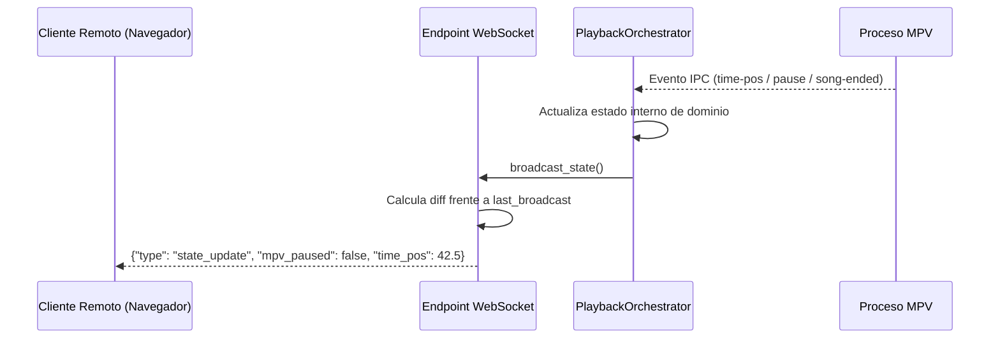
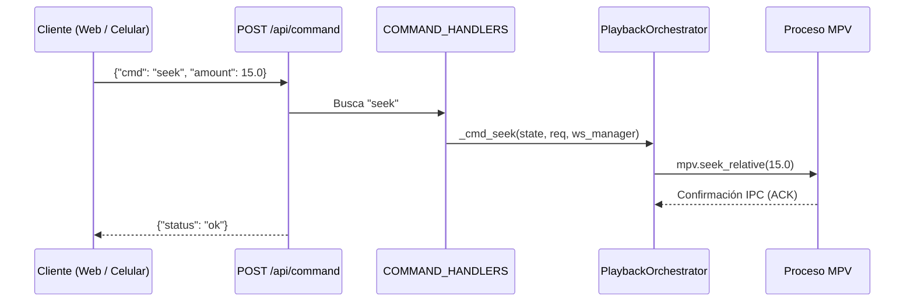

# Arquitectura y Diseño del Sistema — La Rockola del Carpincho

La Rockola del Carpincho está diseñada siguiendo los principios de la **Arquitectura Hexagonal (Puertos y Adaptadores)**, con una separación estricta de responsabilidades y flujo unidireccional de datos. Esta estructura mantiene el núcleo de reproducción y la gestión de colas completamente aislados de efectos secundarios externos como motores de audio, sockets IPC, D-Bus y frameworks web.

```text
                    ┌─────────────────────────────────────────┐
                    │               CLI y Entrada             │
                    │   server.py / app.cli.entrypoint        │
                    └────────────────────┬────────────────────┘
                                         │
                    ┌────────────────────▼────────────────────┐
                    │      Entrega y API (HTTP / WebSockets)  │
                    │    app.api (Comandos, WebSockets, REST) │
                    └────────────────────┬────────────────────┘
                                         │
                    ┌────────────────────▼────────────────────┐
                    │            Núcleo de Dominio            │
                    │ app.domain.playback.PlaybackOrchestrator│
                    │  ├── QueueManager                       │
                    │  ├── DjCarpinchoSelector                │
                    │  ├── RadioService                       │
                    │  └── LibraryService                     │
                    └──────────┬───────────────────┬──────────┘
                               │                   │
       ┌───────────────────────▼─────────┐ ┌───────▼──────────────────────────┐
       │     Infraestructura y Drivers   │ │   Persistencia y Almacenamiento  │
       │  app.infrastructure.mpv (IPC)   │ │  app.infrastructure.db           │
       │  app.infrastructure.mpris (DBus)│ │  ├── Repositorios (Tracks, Favs) │
       │  app.infrastructure.media (TTS) │ │  └── Migraciones SQLite          │
       │  app.infrastructure.weather     │ │                                  │
       └─────────────────────────────────┘ └──────────────────────────────────┘
```

---

## 1. Estructura de Directorios

```text
.
├── app/                                       # Aplicación backend en Python
│   ├── api/                                   # Adaptadores de entrada: rutas HTTP, WebSockets y despachadores
│   │   ├── commands.py                        # Tabla declarativa de comandos (COMMAND_HANDLERS)
│   │   ├── library.py                         # Endpoints REST de la biblioteca (canciones, estado de escaneo)
│   │   ├── media.py                           # Streaming de audio y resolución de carátulas
│   │   ├── middleware.py                      # Soporte de peticiones por rango (HTTP 206) y CORS
│   │   ├── router.py                          # Agregador de rutas API (/api/v1 y compatibilidad hacia atrás)
│   │   ├── schemas.py                         # Modelos Pydantic para requests, responses y mensajes WS
│   │   ├── system.py                          # Endpoints de salud, capacidades del sistema y versión
│   │   └── websocket.py                       # Gestor de conexiones WebSocket y difusión en tiempo real
│   ├── cli/                                   # Presentación: interfaz de línea de comandos y setup interactivo
│   │   ├── entrypoint.py                      # Parseo de CLI, codificación de consola y paquetes del sistema
│   │   └── wizard.py                          # Asistente de configuración en terminal para el primer inicio
│   ├── core/                                  # Módulos transversales y fundacionales
│   │   ├── config.py                          # Ajustes con Pydantic Settings, directorios y lectura de config
│   │   ├── container.py                       # Contenedor de inyección de dependencias (AppContainer)
│   │   ├── logging.py                         # Configuración estandarizada de logs con salida coloreada
│   │   └── network.py                         # Resolución de IP local y armado de URLs del servidor
│   ├── domain/                                # Reglas puras de negocio y orquestadores del dominio
│   │   ├── dj/                                # Selección autónoma de canciones de DJ Carpincho
│   │   │   └── selector.py                    # Reglas de transición, coincidencia por estado de ánimo y anti-repetición
│   │   ├── library/                           # Modelos de canciones, escaneo de carpetas y extracción de audio
│   │   │   ├── hasher.py                      # Hasheo rápido de archivos en bloques
│   │   │   ├── models.py                      # Modelos de dominio TrackMetadata y TrackSummary
│   │   │   ├── mood.py                        # Extracción de características (BPM, energía, centroide)
│   │   │   └── service.py                     # Escaneo en segundo plano y extracción de portadas
│   │   ├── playback/                          # Dominio de reproducción
│   │   │   └── orchestrator.py                # PlaybackOrchestrator: coordina cola, radio, mpv y mpris
│   │   ├── queue/                             # Dominio de cola de reproducción
│   │   │   └── manager.py                     # QueueManager: historial, cola, reproducción aleatoria y reordenamiento
│   │   └── radio/                             # Dominio de Modo Radio
│   │       ├── banks.py                       # Bancos de diálogo, entradillas, tablas de prosodia y contextos
│   │       ├── dialogue.py                    # Generador de turnos de locución y ensamblado de guiones
│   │       ├── nlp.py                         # Validación morfológica rioplatense y limpieza de frases
│   │       └── service.py                     # Sintetizador de anuncios y pregeneración en segundo plano
│   ├── infrastructure/                        # Adaptadores de salida (drivers, binarios y persistencia)
│   │   ├── binaries/                          # Resolutores y auto-descargadores de binarios del sistema
│   │   │   ├── ffmpeg.py                      # Adaptadores para FFmpeg y FFprobe
│   │   │   ├── fpcalc.py                      # Adaptador para Chromaprint fpcalc
│   │   │   ├── manager.py                     # Detección de binarios por plataforma, extracción y entorno
│   │   │   ├── mpv.py                         # Instalador de MPV portable y buscador de rutas
│   │   │   └── ytdlp.py                       # Descargador y adaptador de invocación para yt-dlp
│   │   ├── db/                                # Persistencia
│   │   │   ├── connection.py                  # Fábrica de conexiones SQLite (WAL, busy timeout, foreign keys)
│   │   │   ├── migrations.py                  # Versionado de esquemas y ejecutor de migraciones
│   │   │   └── repositories.py                # Repositorios de Canciones, Favoritos, Historial y URLs
│   │   ├── media/                             # Manipulación de audio
│   │   │   ├── mixer.py                       # Mezcla mediante grafos de filtros FFmpeg, ducking y masterización
│   │   │   └── tts_cache.py                   # Sintetizador Edge-TTS con caché de blobs en SQLite
│   │   ├── mpris/                             # Integración con el escritorio
│   │   │   └── adapter.py                     # Proveedor D-Bus MPRIS v2 (OrgMprisMediaPlayer2)
│   │   ├── mpv/                               # Controlador del reproductor multimedia
│   │   │   └── controller.py                  # AsyncMpvController: protocolo JSON IPC sobre socket Unix/pipe
│   │   └── weather/                           # Clientes de información externa
│   │       └── client.py                      # Cliente wttr.in con caché en memoria y logs de diagnóstico
│   └── main.py                                # Fábrica de la aplicación FastAPI, middlewares y lifespan
├── scripts/                                   # Scripts auxiliares de empaquetado y construcción
├── src/                                       # Frontend SPA en Vue 3
│   ├── assets/                                # Recursos estáticos y fuentes tipográficas
│   ├── audio/                                 # Drivers de audio para navegador (media session, morse keepalive)
│   ├── components/                            # Componentes de interfaz de usuario y pestañas
│   │   ├── ui/                                # Controles primitivos reutilizables (botones, sliders, filas)
│   │   ├── ContextMenu.vue                    # Menú contextual global
│   │   ├── ControlsTab.vue                    # Pestaña principal del reproductor (barra de progreso, volumen, carátula)
│   │   ├── FloatingPlayer.vue                 # Reproductor inferior compacto
│   │   ├── FogonMode.vue                      # Visualizador a pantalla completa para Modo Fogón
│   │   ├── LibraryTab.vue                     # Explorador de biblioteca, filtros de temas y búsqueda
│   │   ├── QueueTab.vue                       # Cola, historial, acciones de deslizamiento y arrastrar y soltar
│   │   ├── TopTab.vue                         # Pistas más escuchadas y estadísticas
│   │   └── WeatherLocationModal.vue           # Modal para configurar la ciudad del reporte meteorológico
│   ├── composables/                           # Lógica de presentación y estado reactivo
│   │   ├── player/                            # Composables especializados de reproducción
│   │   │   ├── state.ts                       # Adaptador de estado para compatibilidad
│   │   │   ├── useCommands.ts                 # Despachadores de comandos HTTP y WebSocket
│   │   │   ├── useHaptics.ts                  # Retroalimentación por vibración en dispositivos móviles
│   │   │   ├── useLibrary.ts                  # Integración del estado de la biblioteca
│   │   │   ├── useLocalPlayback.ts            # Sincronización del elemento de audio del navegador en clientes remotos
│   │   │   ├── useMpvWindow.ts                # Gestión de la ventana de MPV en el escritorio
│   │   │   ├── useQueue.ts                    # Acciones y mutaciones de la cola
│   │   │   ├── useQueueDragDrop.ts            # Gestos táctiles y drag-and-drop HTML5 / Touch
│   │   │   ├── useSocket.ts                   # Conexión WebSocket resiliente con bucle de reconexión
│   │   │   ├── useTabs.ts                     # Estado de navegación entre pestañas
│   │   │   └── useToasts.ts                   # Notificaciones emergentes (toasts)
│   │   ├── useApi.ts                          # Envoltorio de bajo nivel para Fetch
│   │   ├── useCover.ts                        # Resolución y fallback de URLs de carátulas
│   │   ├── useKeyboardShortcuts.ts            # Atajos de teclado globales
│   │   └── useLyrics.ts                       # Parser de archivos LRC sincronizados y seguimiento de líneas
│   ├── stores/                                # Stores reactivas modulares estilo Pinia
│   │   ├── useLibraryStore.ts                 # Catálogo de temas, consulta de búsqueda y progreso de escaneo
│   │   ├── usePlaybackStore.ts                # Posición de reproducción, volumen, duración y pausa
│   │   ├── useQueueStore.ts                   # Lista de reproducción activa, historial y pausa al terminar tema
│   │   ├── useRadioStore.ts                   # Estado de modo radio, locutor actual y ubicación del clima
│   │   └── useUiStore.ts                      # Pestaña activa, modales y configuración visual
│   ├── types/                                 # Definiciones fuertemente tipadas en TypeScript
│   │   ├── library.ts                         # Interfaces de biblioteca y modelos de pistas
│   │   ├── player.ts                          # Estado del reproductor y contratos de comandos
│   │   └── websocket.ts                       # Tipos discriminados para mensajes WebSocket
│   ├── App.vue                                # Vista raíz y oyentes de eventos globales
│   └── main.ts                                # Inicialización de la aplicación cliente
├── tests/                                     # Batería de pruebas automatizadas
│   ├── frontend/                              # Pruebas en Vitest para componentes y composables Vue
│   ├── test_stage1_infrastructure.py          # Repositorios, hasher, migraciones y socket IPC
│   ├── test_stage2_domain.py                  # Orquestador de reproducción, cola y DJ Carpincho
│   ├── test_stage3_api_and_cli.py             # Endpoints FastAPI, sincronización WS y parser CLI
│   ├── test_stage4_regressions.py             # D-Bus MPRIS, generadores de base de datos y seguridad Zip-slip
│   ├── test_stage5_radio_and_audit.py         # Cadena de masterización de radio, diálogo y NLP
│   └── test_stage6_audit_and_observability.py # Logs de diagnóstico y auditoría de contratos TDD
├── server.py                                  # Script ejecutable principal
├── vite.config.ts                             # Configuración del empaquetador Vite
└── vitest.config.ts                           # Configuración del ejecutor de pruebas Vitest
```

---

## 2. Capas Arquitectónicas y Responsabilidades

### Capa de Dominio (`app/domain`)

La capa de dominio contiene todas las reglas de negocio y máquinas de estado del sistema. No tiene **ninguna dependencia** de FastAPI, WebSockets ni frameworks de UI:

- **`PlaybackOrchestrator`**: Es la raíz de agregación que sincroniza los temas, gestiona las transiciones de fin de archivo (EOF), coordina la pregeneración en segundo plano y despacha las actualizaciones de estado.
- **`QueueManager`**: Encapsula las operaciones sobre la cola (encolar, desencolar, mezclar aleatoriamente, historial de reproducción, saltos directos y pausa tras el tema actual).
- **`DjCarpinchoSelector`**: Selector autónomo de canciones que pondera las pistas según la frecuencia de reproducción, etiquetas de estado de ánimo (energía, valencia) y variedad de géneros.
- **`RadioService`**: Gestiona la máquina de estados de locución radial, generación de diálogos dinámicos, reporte del clima y síntesis anticipada en segundo plano.
- **`LibraryService`**: Escanea el sistema de archivos, calcula hashes (`hasher.py`), extrae metadatos con Mutagen y delega el análisis acústico (`mood.py`).

### Capa de Infraestructura (`app/infrastructure`)

Los adaptadores de infraestructura implementan los detalles técnicos y dialogan con el sistema operativo:

- **`AsyncMpvController`**: Inicializa y controla el proceso de MPV mediante JSON IPC sobre sockets de dominio Unix (Linux/macOS) o tuberías nombradas (Windows).
- **`MPRISService`**: Registra las interfaces D-Bus (`org.mpris.MediaPlayer2` y `org.mpris.MediaPlayer2.Player`) para integrar controles multimedia del sistema y notificaciones de escritorio.
- **`Base de Datos y Repositorios`**: Base SQLite configurada en modo WAL con claves foráneas activadas. Los repositorios aíslan las consultas SQL del resto del sistema.
- **`Mezclador de Audio`**: Ejecuta grafos de filtros multicanal en FFmpeg (ducking de música bajo la voz, filtros de normalización para radiodifusión y ruido de sala ambiental).
- **`Caché TTS`**: Conecta con Edge-TTS y almacena los audios sintetizados en SQLite para minimizar la latencia de red y permitir reproducción offline recurrente.
- **`Resolutores de Binarios y Auto-Descarga`**: Detecta y resuelve binarios empaquetados, portables o del sistema (`mpv`, `ffmpeg`, `fpcalc`, `yt-dlp`). Tanto en versiones portables como en ejecuciones desde código fuente, los binarios faltantes se descargan y verifican en el directorio de usuario (`~/.carpincho` / `%APPDATA%\Carpincho`), con degradación elegante si no hay conexión.

### Capa de API y Entrega (`app/api`)

Expone los puertos hacia el cliente web y controladores remotos:

- **`commands.py`**: Tabla declarativa (`COMMAND_HANDLERS: dict[str, CommandHandlerFn]`) que elimina estructuras de bifurcación complejas y despacha cadenas de comando a funciones fuertemente tipadas.
- **`websocket.py`**: `ConnectionManager` gestiona los sockets de clientes activos, valida instancias de reproductores locales y difunde diffs JSON incrementales cuando cambia el estado.
- **`middleware.py`**: Añade soporte para solicitudes por rango (HTTP 206 Partial Content), clave para streaming y saltos en la pista, junto con cabeceras CORS.

### Arquitectura del Frontend (`src/`)

La interfaz de usuario en Vue 3 sigue un diseño modular y reactivo sin estados duplicados:

- **Stores (`src/stores/`)**: Almacenan el estado reactivo aislado (`usePlaybackStore`, `useQueueStore`, `useLibraryStore`, `useRadioStore`, `useUiStore`).
- **Composables (`src/composables/`)**: Encapsulan la lógica de interacción con el usuario (reordenamiento por drag-and-drop, gestos de deslizamiento, atajos de teclado y visualización).
- **Sincronización por WebSocket (`useSocket.ts`)**: Recibe los diffs de `state_update` emitidos por el servidor y actualiza las stores reactivas en tiempo real.

---

## 3. Patrones de Comunicación

### Sincronización de Estado en Tiempo Real (Difusión de Diffs)



### Despacho de Comandos


