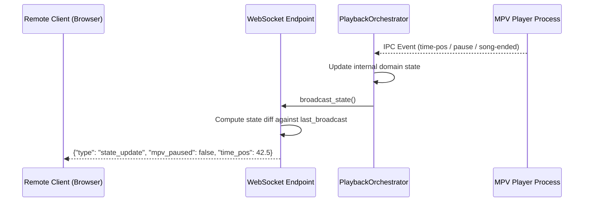
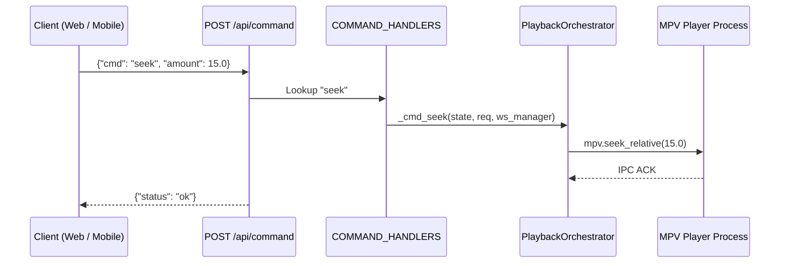

# Architecture & System Design — La Rockola del Carpincho

La Rockola del Carpincho is engineered around **Hexagonal Architecture (Ports and Adapters)**, strict separation of concerns, and unidirectional data flow. This structure keeps the core playback and queue management independent of external side effects like audio engines, desktop IPC sockets, D-Bus, and web frameworks.

```
                    ┌─────────────────────────────────────────┐
                    │               CLI & Entry               │
                    │   server.py / app.cli.entrypoint        │
                    └────────────────────┬────────────────────┘
                                         │
                    ┌────────────────────▼────────────────────┐
                    │           Delivery & API (HTTP/WS)      │
                    │    app.api (Commands, WebSockets, REST) │
                    └────────────────────┬────────────────────┘
                                         │
                    ┌────────────────────▼────────────────────┐
                    │               Domain Core               │
                    │ app.domain.playback.PlaybackOrchestrator│
                    │  ├── QueueManager                       │
                    │  ├── DjCarpinchoSelector                │
                    │  ├── RadioService                       │
                    │  └── LibraryService                     │
                    └──────────┬───────────────────┬──────────┘
                               │                   │
      ┌────────────────────────▼────────┐ ┌────────▼─────────────────────────┐
      │     Infrastructure & Drivers    │ │        Storage & Persistence     │
      │  app.infrastructure.mpv (IPC)   │ │  app.infrastructure.db           │
      │  app.infrastructure.mpris (DBus)│ │  ├── Repositories (Tracks, Favs) │
      │  app.infrastructure.media (TTS) │ │  └── SQLite Migrations           │
      │  app.infrastructure.weather     │ │                                  │
      └─────────────────────────────────┘ └──────────────────────────────────┘
```

---

## 1. Directory Structure

```text
.
├── app/                                       # Python backend application
│   ├── api/                                   # Inbound adapters: HTTP routes, WebSockets & command dispatchers
│   │   ├── commands.py                        # Declarative command table (COMMAND_HANDLERS)
│   │   ├── library.py                         # Library REST endpoints (tracks, scan status)
│   │   ├── media.py                           # Media streaming and cover art resolution
│   │   ├── middleware.py                      # Range requests and CORS handling
│   │   ├── router.py                          # API route aggregator (/api/v1 and legacy shims)
│   │   ├── schemas.py                         # Pydantic schemas for requests, responses, and WS messages
│   │   ├── system.py                          # Health, system capabilities, and version endpoints
│   │   └── websocket.py                       # WebSocket connection manager & real-time broadcast
│   ├── cli/                                   # Presentation: command-line interface & interactive setup
│   │   ├── entrypoint.py                      # CLI parser, console encoding, system package setup
│   │   └── wizard.py                          # Terminal setup wizard for first-run configuration
│   ├── core/                                  # Cross-cutting foundational modules
│   │   ├── config.py                          # Pydantic Settings, app directories, config file I/O
│   │   ├── container.py                       # Dependency injection container (AppContainer)
│   │   ├── logging.py                         # Standardized logging setup with colorized output
│   │   └── network.py                         # Local IP resolution and server URL construction
│   ├── domain/                                # Pure business rules and domain orchestrators
│   │   ├── dj/                                # DJ Carpincho autonomous playlist generation
│   │   │   └── selector.py                    # Transition rules, mood matching, anti-repetition logic
│   │   ├── library/                           # Track models, directory scanner, and audio features
│   │   │   ├── hasher.py                      # Fast chunked file hashing
│   │   │   ├── models.py                      # TrackMetadata, TrackSummary domain models
│   │   │   ├── mood.py                        # Audio analysis extraction (BPM, energy, centroid)
│   │   │   └── service.py                     # Background scanning & cover art extraction
│   │   ├── playback/                          # Playback domain
│   │   │   └── orchestrator.py                # PlaybackOrchestrator: coordinates queue, radio, mpv & mpris
│   │   ├── queue/                             # Queue domain
│   │   │   └── manager.py                     # QueueManager: history, queue, shuffle, track reordering
│   │   └── radio/                             # Radio Mode domain
│   │       ├── banks.py                       # Dialogue pools, lead-ins, prosody tables, contexts
│   │       ├── dialogue.py                    # Radio dialogue turn generator and script assembly
│   │       ├── nlp.py                         # Rioplatense morphological validation & fortune-es cleaner
│   │       └── service.py                     # Radio announcement synthesizer & background pregenerator
│   ├── infrastructure/                        # Outbound adapters (drivers, system binaries, persistence)
│   │   ├── binaries/                          # System binary resolvers & auto-downloaders
│   │   │   ├── ffmpeg.py                      # FFmpeg & FFprobe adapters
│   │   │   ├── fpcalc.py                      # Chromaprint fpcalc adapter
│   │   │   ├── manager.py                     # Platform binary detection, extractors, and environment
│   │   │   ├── mpv.py                         # Portable MPV installer & path finder
│   │   │   └── ytdlp.py                       # yt-dlp binary downloader and invocation adapter
│   │   ├── db/                                # Persistence
│   │   │   ├── connection.py                  # SQLite connection factory (WAL, busy timeout, foreign keys)
│   │   │   ├── migrations.py                  # Schema versioning and migration runners
│   │   │   └── repositories.py                # Track, Favorite, History, and UrlLog repositories
│   │   ├── media/                             # Audio manipulation
│   │   │   ├── mixer.py                       # FFmpeg filtergraph audio mixing, ducking, mastering
│   │   │   └── tts_cache.py                   # Edge-TTS synthesizer with SQLite blob caching
│   │   ├── mpris/                             # Desktop integration
│   │   │   └── adapter.py                     # D-Bus MPRIS v2 provider (OrgMprisMediaPlayer2)
│   │   ├── mpv/                               # Media player controller
│   │   │   └── controller.py                  # AsyncMpvController: JSON IPC protocol over Unix socket/pipe
│   │   └── weather/                           # External information clients
│   │       └── client.py                      # wttr.in client with in-memory caching and diagnostic logs
│   └── main.py                                # FastAPI application factory, middleware, lifespan hooks
├── scripts/                                   # Packaging and build helper scripts
├── src/                                       # Vue 3 Frontend SPA
│   ├── assets/                                # Static assets and fonts
│   ├── audio/                                 # Browser audio drivers (media session, morse keepalive)
│   ├── components/                            # UI components and tabs
│   │   ├── ui/                                # Reusable primitive controls (buttons, sliders, rows)
│   │   ├── ContextMenu.vue                    # Global context menu
│   │   ├── ControlsTab.vue                    # Main player tab (scrubber, volume, cover art)
│   │   ├── FloatingPlayer.vue                 # Compact bottom player
│   │   ├── FogonMode.vue                      # Campfire / Party full-screen visualizer
│   │   ├── LibraryTab.vue                     # Library browser, track filters, search
│   │   ├── QueueTab.vue                       # Queue, history, swipe actions, drag-and-drop
│   │   ├── TopTab.vue                         # Most played tracks and statistics
│   │   └── WeatherLocationModal.vue           # Weather location configuration modal
│   ├── composables/                           # Business logic and presentation state
│   │   ├── player/                            # Specialized player composables
│   │   │   ├── state.ts                       # Backward-compatibility state adapter
│   │   │   ├── useCommands.ts                 # HTTP/WebSocket command dispatchers
│   │   │   ├── useHaptics.ts                  # Mobile vibration feedback
│   │   │   ├── useLibrary.ts                  # Library state integration
│   │   │   ├── useLocalPlayback.ts            # Browser audio element sync for remote clients
│   │   │   ├── useMpvWindow.ts                # Desktop MPV window management
│   │   │   ├── useQueue.ts                    # Queue actions and mutations
│   │   │   ├── useQueueDragDrop.ts            # HTML5 / Touch drag-and-drop and swipe gestures
│   │   │   ├── useSocket.ts                   # Resilient WebSocket connection & reconnect loop
│   │   │   ├── useTabs.ts                     # Tab navigation state
│   │   │   └── useToasts.ts                   # Toast notification helpers
│   │   ├── useApi.ts                          # Low-level Fetch wrapper
│   │   ├── useCover.ts                        # Cover art URL resolution and fallback
│   │   ├── useKeyboardShortcuts.ts            # Global keyboard shortcuts
│   │   └── useLyrics.ts                       # Synchronized LRC parser and line tracking
│   ├── stores/                                # Modular Pinia-style reactive stores
│   │   ├── useLibraryStore.ts                 # Track catalog, search query, scan progress
│   │   ├── usePlaybackStore.ts                # Playback position, volume, track duration, pause state
│   │   ├── useQueueStore.ts                   # Active playlist, past history, pause-after-track
│   │   ├── useRadioStore.ts                   # Radio mode status, current speaker, weather location
│   │   └── useUiStore.ts                      # Active tab, modals, theme settings
│   ├── types/                                 # Strongly typed TypeScript definitions
│   ├── App.vue                                # Root layout and global listeners
│   └── main.ts                                # Client application bootstrap
├── tests/                                     # Test suites
│   ├── frontend/                              # Vitest suites for Vue components and composables
│   ├── test_stage1_infrastructure.py          # Repositories, hasher, migrations, IPC
│   ├── test_stage2_domain.py                  # Playback orchestrator, queue, DJ Carpincho
│   ├── test_stage3_api_and_cli.py             # FastAPI endpoints, WebSocket sync, CLI parser
│   ├── test_stage4_regressions.py             # D-Bus MPRIS, DB generators, Zip-slip guards
│   ├── test_stage5_radio_and_audit.py         # Radio mastering chain, dialog planning, NLP
│   └── test_stage6_audit_and_observability.py # Diagnostic logging, TDD contract audit
├── server.py                                  # Top-level executable script
├── vite.config.ts                             # Vite bundler configuration
└── vitest.config.ts                           # Vitest runner configuration
```

---

## 2. Architectural Layers & Responsibilities

### Domain Layer (`app/domain`)

The domain layer encapsulates all core business rules and state machines. It has **no dependency** on FastAPI, WebSockets, or UI frameworks:

- **`PlaybackOrchestrator`**: The aggregate root that synchronizes tracks, handles EOF transitions, coordinates background pregeneration, and dispatches state updates.
- **`QueueManager`**: Encapsulates queue operations (enqueue, dequeue, shuffle, history tracking, jumping, and pause-after-track).
- **`DjCarpinchoSelector`**: Autonomous song selector that computes track weights based on play count recency, mood tags (energy, valence), and genre diversity.
- **`RadioService`**: Manages the radio synthesis state machine, dialogue generation, dynamic speech turns, weather forecasts, and background announcement pregeneration.
- **`LibraryService`**: Scans the filesystem, computes file hashes (`hasher.py`), extracts metadata tags via Mutagen, and delegates audio feature extraction (`mood.py`).

### Infrastructure Layer (`app/infrastructure`)

Infrastructure adapters implement technical details and communicate with the operating system:

- **`AsyncMpvController`**: Spawns and manages the MPV process, communicating via JSON IPC over Unix domain sockets (Linux/macOS) or Named Pipes (Windows).
- **`MPRISService`**: Registers D-Bus interfaces (`org.mpris.MediaPlayer2` and `org.mpris.MediaPlayer2.Player`) to support system media keys and desktop notifications.
- **`Database & Repositories`**: SQLite database configured with Write-Ahead Logging (WAL) and foreign key constraints. Repositories isolate SQL queries from business logic.
- **`Media Mixer`**: Executes multi-track audio graphs in FFmpeg (ducking background music under synthesized speech, applying broadcast normalization filters and room tone).
- **`TTS Cache`**: Interacts with Edge-TTS and stores synthesized audio blobs in SQLite to minimize remote API latency and support offline repeats.
- **`Binary Resolvers & Auto-Downloader`**: Auto-detects and resolves bundled, portable, and system binaries (`mpv`, `ffmpeg`, `fpcalc`, `yt-dlp`). Across both standalone releases (AppImage / portable ZIP) and source runs, missing binaries are automatically fetched, verified, and cached into the user data directory (`~/.carpincho` / `%APPDATA%\Carpincho`) with graceful feature degradation when offline.

### API & Delivery Layer (`app/api`)

Exposes ports to the web client and remote controllers:

- **`commands.py`**: A declarative lookup table (`COMMAND_HANDLERS: dict[str, CommandHandlerFn]`) eliminates cascading conditional blocks and maps string commands to strongly typed handlers.
- **`websocket.py`**: `ConnectionManager` maintains active client sockets, authenticates local player instances, and broadcasts incremental JSON diffs when state attributes change.
- **`middleware.py`**: Provides HTTP 206 Partial Content support for audio streaming, seek operations, and CORS headers.

### Frontend Store & Composable Architecture (`src/`)

The Vue 3 frontend follows a modular, reactive architecture without duplicate state:

- **Stores (`src/stores/`)**: Provide isolated reactive state stores (`usePlaybackStore`, `useQueueStore`, `useLibraryStore`, `useRadioStore`, `useUiStore`).
- **Composables (`src/composables/`)**: Encapsulate user interaction logic (drag-and-drop reordering, swipe to remove, keyboard navigation, and audio visualization).
- **WebSocket Synchronization (`useSocket.ts`)**: Ingests `state_update` diffs from the server and updates Pinia-style reactive stores in real time.

---

## 3. Communication Patterns

### Real-time State Synchronization (Diff Broadcasting)



### Command Dispatching


